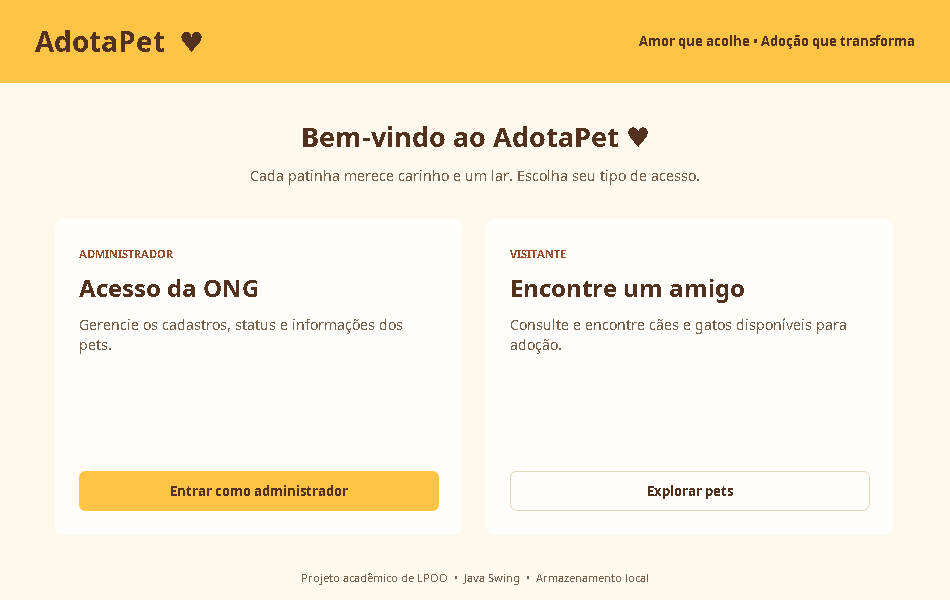
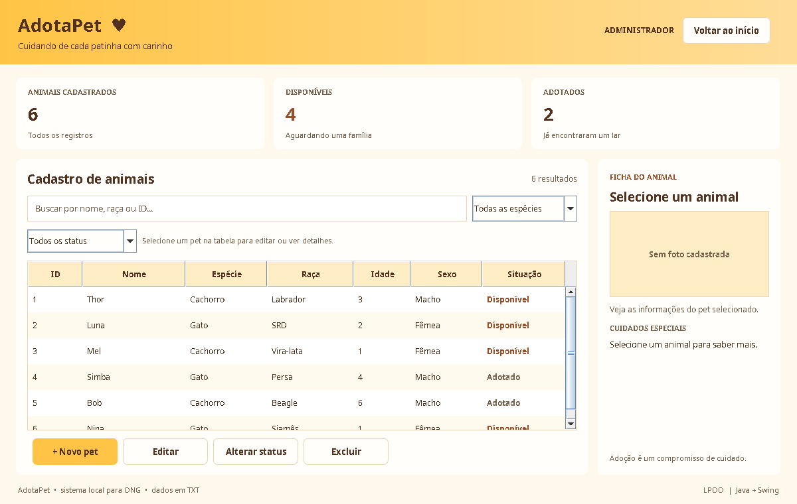
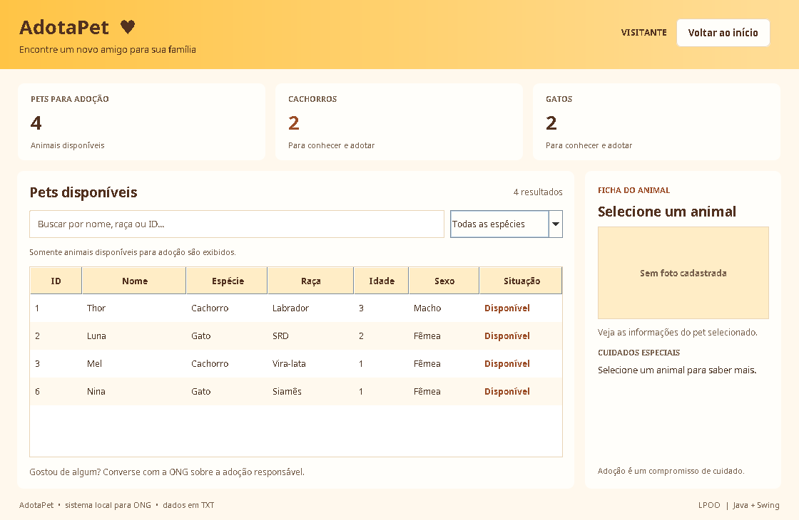
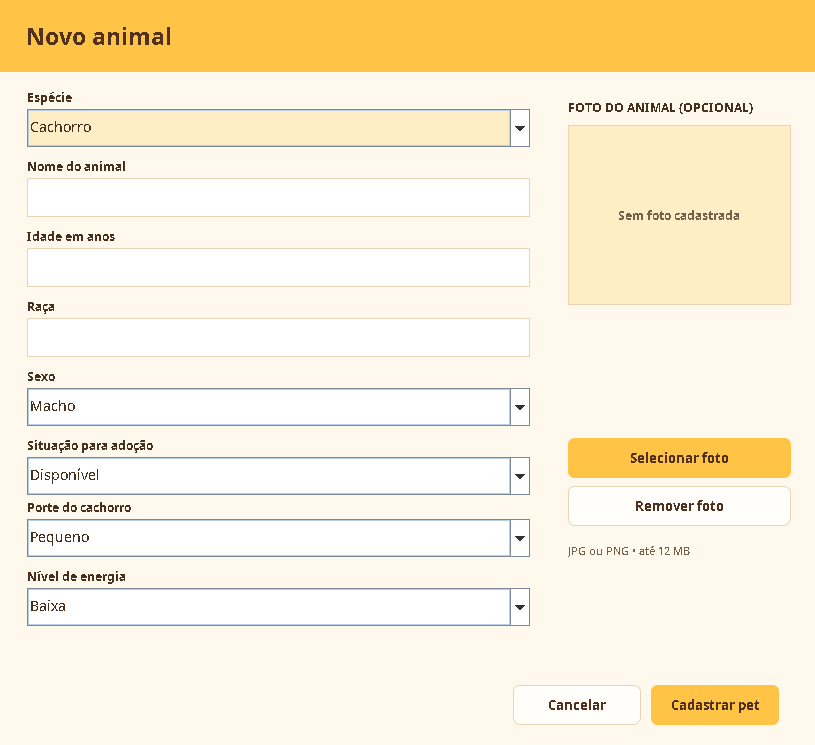
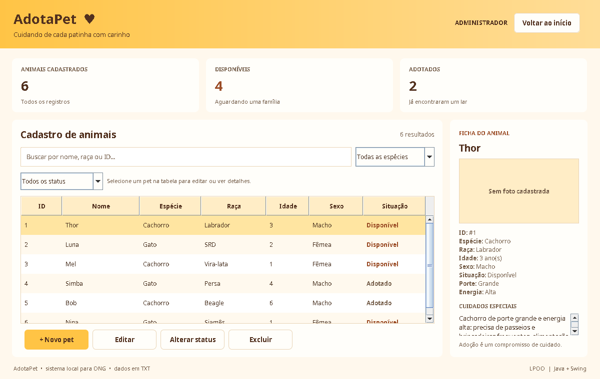
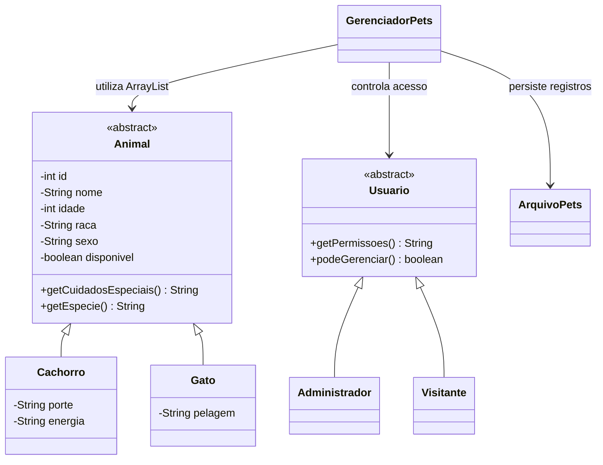

# AdotaPet — Sistema de adoção de cães e gatos ♥

Projeto acadêmico de **Linguagem de Programação Orientada a Objetos (LPOO)**. Aplicativo **desktop e offline**, desenvolvido em **Java + Swing**, para uma ONG manter o cadastro de pets e permitir consultas públicas dos animais disponíveis.

O trabalho foi organizado conforme o enunciado da professora e o planejamento do AdotaPet: herança, polimorfismo, exceções, coleções, leitura/gravação em TXT e interface gráfica. Não requer internet, banco de dados, bibliotecas externas nem cadastro real de adotantes.

## Identidade visual "Amarelo Mel" ♥

A interface recebeu uma paleta mais calorosa e acolhedora para representar o trabalho de uma ONG de adoção: **amarelo-mel** nos cabeçalhos e botões de ação, **creme** no fundo, **marrom cacau** nos textos e **terracota** nos destaques. O contraste dos botões foi preservado usando letras escuras sobre o amarelo. A personalização foi centralizada na classe `src/adotapet/tela/TemaUI.java` e aplicada também à tabela, à ficha dos pets, à prévia das fotos e às telas do administrador e visitante.

A mudança é **somente visual**: não altera herança, polimorfismo, funcionalidades, formato do `pets.txt` nem a pasta `dados/fotos/`.

## Capturas reais da aplicação

| Tela inicial | Painel do administrador |
|---|---|
|  |  |

| Consulta do visitante | Cadastro de pet |
|---|---|
|  |  |



## Requisitos para executar

- **Java 8 ou superior** para executar o JAR (recomenda-se JDK 17+ ao desenvolver).
- **Apache Ant** para compilar pelo terminal, ou uma instalação do **Apache NetBeans** com suporte a Java.
- Sistema operacional com interface gráfica (Windows, Linux ou macOS).

## Execução rápida (sem abrir NetBeans)

1. Extraia o ZIP inteiro e **não mova somente o JAR**: a pasta `dados/` precisa ficar junto ao projeto.
2. No Windows, dê dois cliques em **`executar.bat`**. No Linux/macOS, execute `./executar.sh`.
3. Se necessário, pelo terminal, abra a pasta do projeto e execute:

```bash
java -jar dist/AdotaPet.jar
```

Para reconstruir o JAR a partir dos fontes, na pasta do projeto:

```bash
ant clean jar
java -jar dist/AdotaPet.jar
```

Se a pasta `dados/` estiver ausente ou o arquivo não existir, a aplicação começa com o cadastro vazio e cria o arquivo ao cadastrar o primeiro pet. O ZIP já inclui **seis cadastros fictícios** de demonstração.

> **Importante:** os caminhos são relativos à **pasta de trabalho atual**. Execute a partir da pasta `AdotaPet/` ou use os lançadores (`executar.bat`/`executar.sh`), que se posicionam nela automaticamente. Os cadastros são salvos em `dados/pets.txt` e as imagens em `dados/fotos/`.
>
> **Se você já tem cadastros:** antes de substituir ou abrir a versão atualizada, faça backup de `dados/pets.txt` e de `dados/fotos/` (se existir). Ao migrar, copie **seu TXT antigo** para a pasta `dados/` da versão nova; o TXT anterior continua compatível. Não substitua seus dados pelos cadastros de demonstração incluídos no ZIP.

## Abrir no Apache NetBeans

1. Extraia o projeto para uma pasta normal do computador.
2. Abra o NetBeans e clique **File > Open Project** (Arquivo > Abrir Projeto).
3. Selecione a pasta **`AdotaPet`**, a que contém `build.xml`, `nbproject/` e `src/`.
4. Se o NetBeans pedir uma plataforma Java, escolha um JDK instalado.
5. Clique em **Run Project (F6)**. Em instalações que não reconheçam a ação de execução pelo painel de projetos, abra `build.xml`, clique com botão direito e execute o alvo **`run`** ou use `ant run` no terminal.
6. A classe principal é `adotapet.Principal`.

### Sobre os arquivos `.form`

As três janelas de navegação, `TelaInicial`, `TelaAdmin` e `TelaVisitante`, incluem pares **`.java` + `.form`** com uma estrutura base em `JFrame` e um contêiner Swing `conteudo`. Os componentes internos mais ricos (tabela, filtros, cartões, formulário modal) são **montados por código Java**, em classes reutilizáveis como `PainelCatalogo`, `DialogoPet` e `TemaUI`.

Isso permite editar as janelas base pelo GUI Builder e estudar a interface em código, mas **o desenho interno não aparece como componentes arrastáveis no editor visual do NetBeans**. Os arquivos `.form` foram estruturados para compatibilidade, porém **a abertura e edição no próprio NetBeans precisam ser conferidas no computador do grupo**, pois não havia NetBeans instalado no ambiente de criação. A aplicação Swing propriamente dita foi compilada e executada em ambiente gráfico.

## Cadastrar e visualizar fotos

1. No acesso de administrador, clique em **+ Novo pet** ou selecione um animal e clique em **Editar**.
2. No formulário, clique **Selecionar foto** e escolha uma imagem **JPG ou PNG**, de até **12 MB**. A prévia aparece à direita.
3. Clique em **Cadastrar pet** ou **Salvar alterações**. A imagem é redimensionada quando necessário (máximo 1200 px por lado) e copiada para `dados/fotos/`.
4. Na tela do administrador **ou visitante**, selecione o animal na tabela: a foto aparece na **Ficha do animal**, à direita.
5. Para remover a foto, edite o animal e clique em **Remover foto**, depois salve.
6. Para testar a persistência, feche o aplicativo, abra novamente e confira a foto do mesmo animal. Consulte [o passo a passo](docs/COMO_USAR_FOTOS.md).

**Observação:** a foto é opcional. Os animais já cadastrados continuam aparecendo, com a indicação “Sem foto cadastrada”, até que uma imagem seja adicionada.

## Acessos para demonstração

| Perfil | Usuário | Senha | Permissões |
|---|---|---|---|
| Administrador | `admin` | `admin123` | Cadastrar, editar, excluir, alterar situação e consultar |
| Visitante | Não precisa | Não precisa | Pesquisar e visualizar apenas os pets disponíveis |

**Atenção:** o login é fixo e **didático**. Não foi criado para implantação real na ONG ou segurança de produção.

## O que o sistema faz

**Administrador:** gerencia cães e gatos (campos comuns: ID, nome, idade, raça, sexo, disponibilidade e **foto opcional**; específicos: porte/energia para cachorro, pelagem para gato). O ID é gerado automaticamente e permanece único mesmo após exclusões e reinicializações. Campos obrigatórios e valores inválidos são rejeitados. A alteração de status não apaga o cadastro.

**Visitante:** pesquisa por nome, raça, espécie ou ID, com busca que aceita diferenças de maiúsculas/minúsculas e acentos. A listagem pública oculta os animais adotados e não permite modificações. Ao selecionar um pet, exibe **sua foto**, informações e cuidados particulares da espécie.

**Persistência:** todas as alterações válidas são gravadas em `dados/pets.txt`, em UTF-8. As imagens selecionadas são copiadas para `dados/fotos/` e apenas seus nomes são gravados no TXT. O arquivo é carregado na inicialização; erros de leitura impedem que o sistema sobrescreva acidentalmente um cadastro possivelmente danificado. Na gravação, um arquivo temporário é criado e só depois substitui o original. Se a gravação falhar, a lista em memória não é modificada.

## Conceitos de LPOO aplicados

| Requisito | Onde está no código |
|---|---|
| Herança | `Cachorro extends Animal`, `Gato extends Animal`, `Administrador/Visitante extends Usuario` |
| Polimorfismo | `Animal.getCuidadosEspeciais()`, `Animal.getEspecie()`, `Usuario.getPermissoes()` e `Usuario.podeGerenciar()` |
| Exceções | `PetException`, `try/catch` de `IOException`, `NumberFormatException`, `IllegalArgumentException` |
| Coleções | `ArrayList<Animal>` dentro de `GerenciadorPets` |
| Leitura e gravação | `ArquivoPets`, usando `BufferedReader` e `PrintWriter`, com UTF-8 |
| Interface gráfica | `JFrame`, `JPanel`, `JTable`, `JTextField`, `JButton`, `JDialog`, `JOptionPane`, `JFileChooser`, `ImageIcon` |

### Árvore de classes



## Estrutura de pastas

```text
AdotaPet/
├── build.xml                  # Compilação, execução e testes com Ant
├── executar.bat / executar.sh # Atalhos de execução
├── nbproject/                 # Configurações compartilháveis do NetBeans
├── src/adotapet/
│   ├── Principal.java          # main / inicialização
│   ├── modelo/                # Animal, Cachorro, Gato, Usuario, Administrador, Visitante
│   ├── servico/               # GerenciadorPets, ArquivoPets, FotoPets
│   ├── excecao/               # PetException
│   └── tela/                  # Swing, GUI Forms, miniaturas e editor de pet
├── test/adotapet/testes/     # Testes automatizados e capturas de interface
├── dados/pets.txt            # Cadastros fictícios de demonstração
├── dados/fotos/              # Fotos JPG/PNG convertidas (criada automaticamente)
├── docs/                     # Capturas e material de apresentação/entrega
└── dist/AdotaPet.jar         # Executável já compilado
```

## Revisão de legibilidade (versão revisada)

Esta edição mantém as regras e a aparência do AdotaPet v2 e melhora a leitura dos arquivos Java:

- Métodos, `if`, `for` e `@Override` antes condensados em uma única linha foram formatados em blocos.
- Foram acrescentados comentários sobre responsabilidades e fluxos nos módulos de interface, cadastro e persistência.
- As constantes da paleta mudaram apenas de **nome**: `MARINHO` → `MARROM_CACAU`, `VERDE` → `AMARELO_MEL`, `VERDE_ESCURO` → `TERRACOTA`, com os **mesmos valores RGB**.
- Uma inicialização anônima compactada de `JPanel` foi substituída por passos explícitos, sem alterar seu aspecto visual.
- Código de leitura/gravação de TXT, validações de negócio, fotos e arquivos `.form` permaneceram com o mesmo comportamento.

A verificação incluiu **compilação Java 8**, **19 testes automatizados aprovados** e **comparação das cinco capturas da interface** antes/depois, sem diferenças de pixels na repetição controlada.

Confira o [relatório completo da revisão](docs/REVISAO_LEGIBILIDADE.md).

## Testes

O projeto inclui testes automatizados sem JUnit, com arquivos temporários independentes do cadastro de demonstração. Execute:

```bash
ant test
```

São verificados login, polimorfismo, CRUD, IDs, permissões, filtros, gravação/leitura, acentuação, validações, arquivos corrompidos e falhas de escrita, **além da importação, remoção, persistência e compatibilidade das fotos** (19 testes). Veja [docs/TESTES.md](docs/TESTES.md).

Também foram realizadas capturas reais da interface Swing com uma tela gráfica virtual, disponíveis nesta pasta.

## Arquivo TXT

Formato legível: primeira linha informa a versão e o próximo ID; linhas seguintes representam cães e gatos. Exemplo:

```text
#ADOTAPET|1|7
CAO|1|Thor|3|Labrador|Macho|true|Grande|Alta
GATO|2|Luna|2|SRD|Fêmea|true|Curta
CAO|3|Mel|1|SRD|Fêmea|true|Pequeno|Média|pet-3-exemplo.png
```

Os registros com foto têm um campo final opcional (`nome-da-foto.png`). Os registros antigos sem esse campo continuam válidos. A terceira linha acima ilustra somente o formato; o nome concreto é gerado automaticamente.

Campos textuais escapam `|`, `\` e quebras de linha, evitando interpretações equivocadas. Não edite manualmente sem fazer cópia de segurança. O formato foi documentado em [docs/ARQUITETURA.md](docs/ARQUITETURA.md).

## Entrega e apresentação

O enunciado informa **23/11/2026** como data da postagem no AVA **e** da apresentação. A entrega exige arquivos `.java` (preferencialmente ZIP), **relatório de participação por integrante**, **formulários e prints de comprovação**. A nota é individual, e o enunciado informa **nota zero no trabalho para quem não participa da apresentação**.

O GitHub é útil para colaboração, mas **não substitui o AVA**, salvo orientação da professora. Veja [docs/CHECKLIST_ENTREGA.md](docs/CHECKLIST_ENTREGA.md), [docs/ROTEIRO_APRESENTACAO.md](docs/ROTEIRO_APRESENTACAO.md) e [docs/RELATORIO_PARTICIPACAO_MODELO.md](docs/RELATORIO_PARTICIPACAO_MODELO.md).

### Limitações assumidas

- Não integra banco de dados, API, agendamentos, cadastro de adotantes ou publicação online (fora do escopo).
- O TXT é local e a aplicação foi pensada para **uma instância por vez**, não para edição simultânea por várias máquinas.
- O login é demonstrativo, não é autenticação adequada a uma ONG real.
- Fotos são locais em `dados/fotos/` (não são publicadas na internet).
- A aplicação e os testes Java foram compilados; a compatibilidade da edição visual `.form` no NetBeans deve ser conferida na instalação local.

**Projeto destinado exclusivamente ao estudo e demonstração acadêmica.**
